# CFS Log Analyzer

The CFS Log Analyzer is the tool used for monitoring and troubleshooting the CFS server, as well as for auditing and creating reports. It displays all available information about user activity and log files. It allows you to view logs, and filter the data however you want. All reports can be exported to Excel. The Log Analyzer is installed on the same machine as the CFS server.

The Log Analyzer is installed on the same machine as the CFS server. You can find the tool here: `C:\Program Files\Radiant Logic Inc\Cloud Federation Service\Tools\RLI.CFS.Tools.Admin.exe`

Navigate to `C:\inetpub\wwwroot\CFS Web Site\cfs\Logs` and click OK.

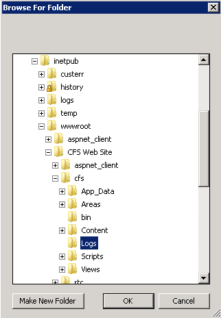

The Log Analyzer has three main sections accessible at the top: Data, Stats, and Logs. Each is described in more details below.

## Data Section

The Data section displays a summary of activity of your server. From here you can get a glimpse of the total amount of log activity per day (shown in the bar chart at the top). If you see any red areas in the chart, this indicates errors have occurred on that particular day. The log details for a selected day are shown below.

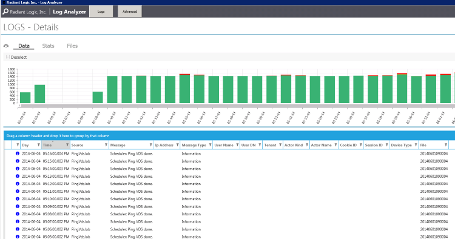

>[!note] If logs are deleted from the Logs directory on the CFS machine, it could compromise the log system.

To change the type of log activity you want to see, click the "filter" button and mark what you are interested in (Connect, ConnectError, Disconnect, Information, Operation, Warning or Error). Only these types of log activities are shown.


## Stats Section

The Stats section allows you to view more detailed information from the logs. Some of the important information is represented graphically (the hours during which the most users are connected, the average time of a user session on the portal).

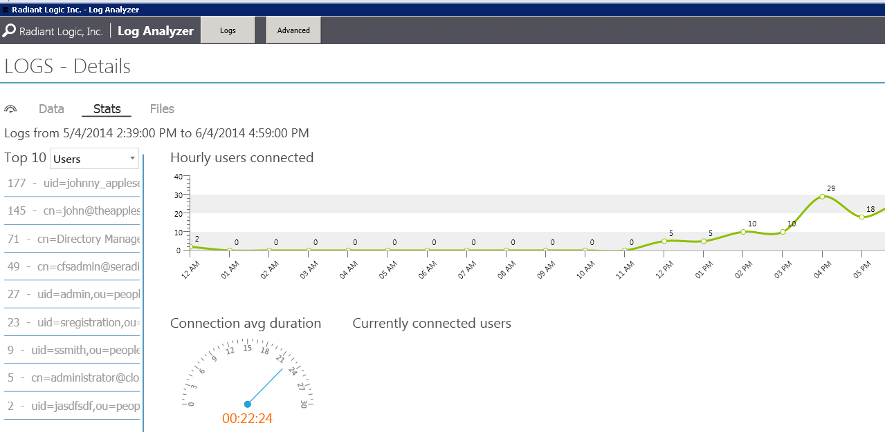

On the left side, the top ten most used applications, the top ten most used Identity providers, and the top ten most connected users can be seen. The default view shows the Top 10 most active users. To view activity for a specific user, select the desired identity from this list.

To view the Top 10 most used applications, click in the drop-down list next to "Top 10" and select Applications.

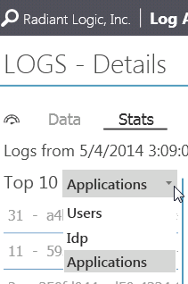

To view the Top 10 most used authentication methods, click in the drop-list next to "Top 10" and select Idp.

On the "Data" section for a selected user, you can see the user’s sessions, cookies, and log content applicable to this user’s actions.

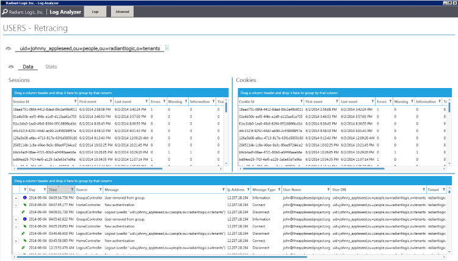

An error related to the user’s activities will be shown with a red "X" button. Click the "+" next to the error to show details like exact error message and stack trace.

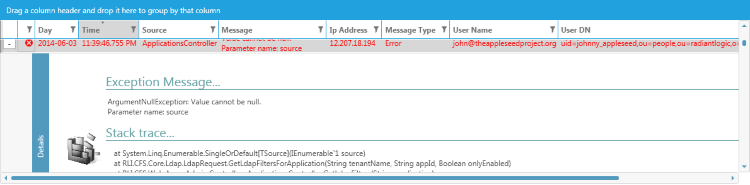

On the "Stats" section for a selected user, you can see a summary of the user’s activities: hourly connections and average duration of the connection.

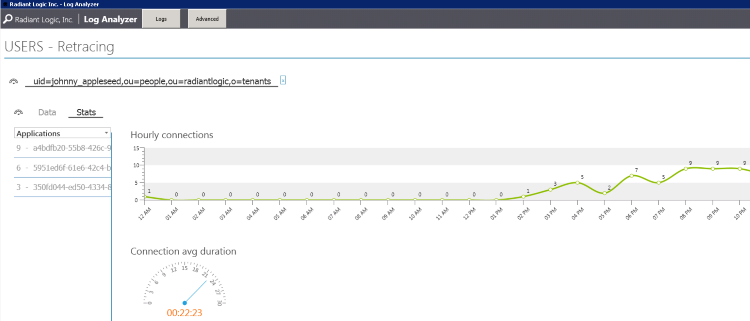

A list of applications (unique GUID) that the user has access will be shown on the left. In the drop-down list, you can select IDP to see a list of authentication methods used by the user.

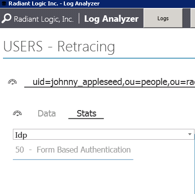

## Files Section

The Files section provides a list of the log files with the number of successful connections, errors, warnings, and so on, for each one.

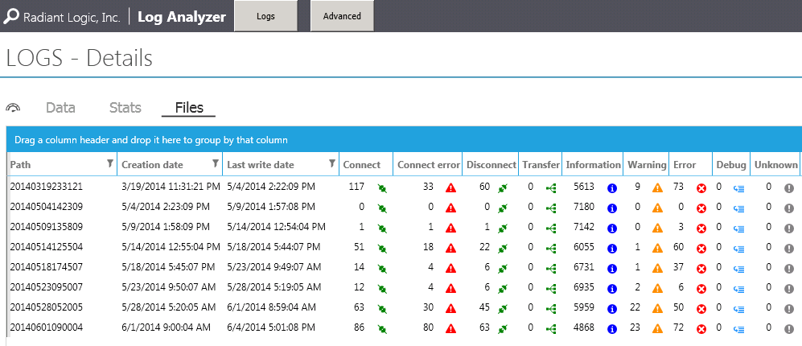

## Refreshing the Log Analysis

To contents of the Log Analyzer are set to update periodically. To refresh the view in the Log Analyzer more frequently than the default interval, click the refresh button in the bottom right corner as often as needed. You can control the auto update and put it on pause/activate it by using the buttons located at the bottom left of the screen.

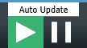

## Advanced Search Page

The log files can be filtered based on a date range. For advanced filtering, click the Advanced button at the top of the Log Analyzer.

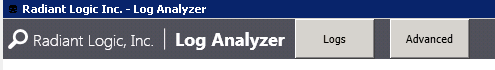

Indicate a Start Date and End Date covering the timeframe of logs you want to analyze. Logs associated with this period of time display.

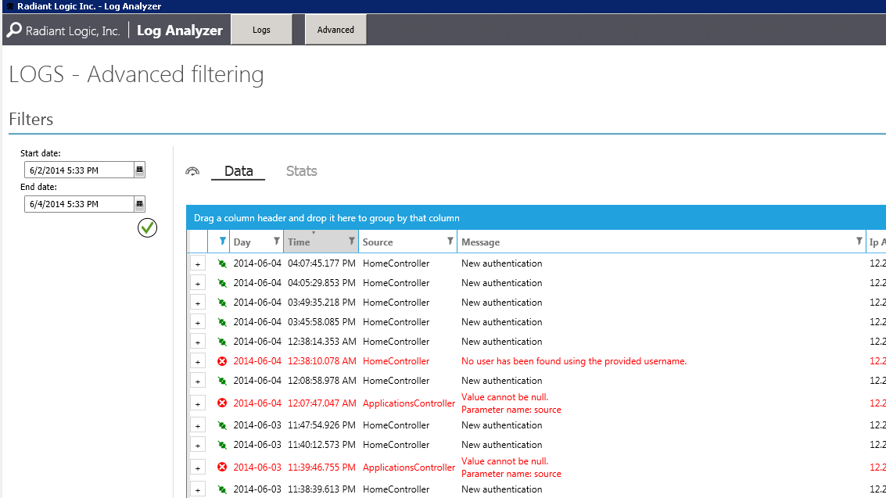

To change the type of log activity you want to see, click the filter button and mark what you are interested in (Connect, ConnectError, Disconnect, Information, Warning or Error). Only these types of log activities are shown.

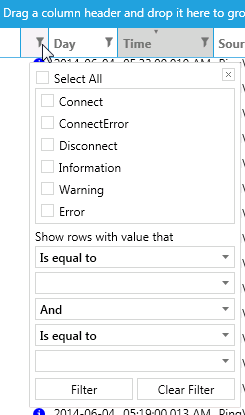

## Performance Counters

Performance counters report how well the operating system, services, and CFS components are performing. Counter data helps you find system bottlenecks and fine-tune system and application performance.

RadiantOne CFS provides two independent sets of performance counters:

- **Component performance counters (CFS v3.18.3 and later):** authentication, federation, session, RTC, API, and portal activity in eight dedicated categories. These are enabled with the `UseCfsPerformanceCounters` setting.
- **Legacy connection counters:** LDAP connection pool usage to FID and HTTP connections to the RSA server (CFS Master), and HTTPS calls from the Web API to CFS Master (CFS Proxy). These are enabled with the `UsePerformanceCounters` setting.

Each set is controlled by its own setting, so you can enable either one or both. Enabling `UseCfsPerformanceCounters` does not change the LDAP, RSA, and Proxy counters.

By default, both sets of counters are disabled.

> [!note] Component counters measure activity inside the CFS process. They are not the same as the IIS `time-taken` value and do not measure end-to-end user latency.

### Component Performance Counters (v3.18.3+)

#### Where the Counters Are Registered

The CFS installers register the counter categories in Windows. Each host registers only the categories its role uses:

| Host | Categories registered | Written by |
|---|---|---|
| CFS Master | All eight component categories | `Cloud Federation Service` application pool (`/cfs`, `/system`, and `/api`) |
| CFS Proxy | Authentication, SAML, WS-Fed, OIDC, Session, Portal | `Cloud Federation Service Proxy` application pool |
| RadiantOne Trust Connector (RTC) | `RadiantOne CFS RTC` only | `RadiantOne Trust Connector` application pool |

The Proxy does not register the API or RTC categories. API counters exist only on the host that runs the API site, which is typically CFS Master.

#### Prerequisites

The application pool identity must have permission to update the counters:

1. On each CFS host, add the application pool identity to the local Windows **Performance Monitor Users** group. By default, this is `IIS_IUSRS` (the application pool's virtual account). If the pool runs under a custom service account, add that account.
2. If a Data Collector Set or monitoring tool collects counter data under a different account, add that account to **Performance Log Users** and **Performance Monitor Users**.
3. After you change group membership, recycle the application pool so its identity picks up the new groups.

#### Enabling Counters on CFS Master

1. Open `C:\inetpub\wwwroot\CFS Web Site\web.config` (or the `web.config` in your CFS installation path).
2. Under `<applicationSettings>` > `<RLI.CFS.Core.Logic.Properties.Settings>`, locate the `UseCfsPerformanceCounters` setting and change its value to `True`:

    ```xml
    <!-- Enable or Disable CFS authentication, federation, session, RTC, API, and portal PerfMon counters -->
    <setting name="UseCfsPerformanceCounters" serializeAs="String">
      <value>True</value>
    </setting>
    ```

    

3. Save the file.
4. In IIS Manager, recycle the `Cloud Federation Service` application pool.

#### Enabling Counters on CFS Proxy

1. On the Proxy host, open `C:\inetpub\wwwroot\CFS Web Site\cfs\web.config` (or the `web.config` in your Proxy installation path).
2. Under `<applicationSettings>` > `<RLI.CFS.Core.Logic.Properties.Settings>`, locate the `UseCfsPerformanceCounters` setting and change its value to `True`:

    ```xml
    <!-- Enable or Disable CFS authentication, federation, session, RTC, API, and portal PerfMon counters -->
    <setting name="UseCfsPerformanceCounters" serializeAs="String">
      <value>True</value>
    </setting>
    ```

    

3. Save the file.
4. In IIS Manager, recycle the `Cloud Federation Service Proxy` application pool.

#### Enabling Counters on RTC

1. Open `Web.config` in the RTC installation directory.
2. Under `<appSettings>`, add or update the following key:

    ```xml
    <add key="UseCfsPerformanceCounters" value="True" />
    ```

3. Save the file.
4. In IIS Manager, recycle the `RadiantOne Trust Connector` application pool.

> [!note]
> CFS opens the counters only when the application pool starts. Changing the setting without recycling the application pool has no effect.

#### Troubleshooting Counters That Stay at Zero

CFS does not log an error when it cannot update a counter. If the component counters show only zeros while there is traffic, check the following:

- `UseCfsPerformanceCounters` is set to `True` in the correct `web.config`, and the application pool was recycled afterward.
- The application pool identity is a member of **Performance Monitor Users**, and the pool was recycled after the membership change.
- You are looking at a category that is registered on this host. For example, the API and RTC categories are not registered on a CFS Proxy host.

### Counters for CFS Master

The legacy counters for CFS Master monitor LDAP connections to FID and HTTP connections to the RSA server.

1. Open `C:\inetpub\wwwroot\CFS Web Site\web.config` (or the `web.config` in your CFS installation path).
2. At the end of the file, locate the RSA and LDAP settings:

    ```xml
    <RLI.CFS.Core.Logic.Properties.Settings>
      <!-- Enable or Disable the Performance Counters for the requests to RSA server -->
      <setting name="UsePerformanceCounters" serializeAs="String">
        <value>False</value>
      </setting>
      ...
    </RLI.CFS.Core.Logic.Properties.Settings>
    <RLI.Core.Ldap.Properties.Settings>
      <!-- Enable or Disable the Performance Counters for the LDAP Queries -->
      <setting name="UsePerformanceCounters" serializeAs="String">
        <value>False</value>
      </setting>
      <!-- Maximum LDAP connections in the pool. Default: 300 -->
      <setting name="MaxPoolSize" serializeAs="String">
        <value>300</value>
      </setting>
    </RLI.Core.Ldap.Properties.Settings>
    ```

3. Set `UsePerformanceCounters` to `True` in the section for the counters you want: `RLI.CFS.Core.Logic.Properties.Settings` for RSA, `RLI.Core.Ldap.Properties.Settings` for LDAP.
4. (Optional) Set `MaxPoolSize`, the maximum number of connections the CFS connection pool can create. The default is `300`.
5. Save the file. IIS automatically restarts the web application and applies the changes.

### Counters for CFS Proxy

The legacy counters for CFS Proxy monitor the HTTPS calls that the Web API makes to CFS Master.

1. Open `C:\inetpub\wwwroot\CFS Web Site\cfs\web.config` (or the `web.config` in your Proxy installation path).
2. At the end of the file, locate the following setting:

    ```xml
    <RLI.CFS.Core.Logic.Properties.Settings>
      <!-- Enable or Disable the Performance Counters for: the Web APIs calls to CFS Master -->
      <setting name="UsePerformanceCounters" serializeAs="String">
        <value>False</value>
      </setting>
      ...
    </RLI.CFS.Core.Logic.Properties.Settings>
    ```

3. Set `UsePerformanceCounters` to `True`.
4. Save the file. IIS automatically restarts the web application and applies the changes.

## Performance Monitor

1. On the Windows host, open Performance Monitor (`perfmon.exe`).
2. In the tree view, select **Monitoring Tools** > **Performance Monitor**.
3. On the toolbar, click the green **Add** button (**+**) to open the **Add Counters** dialog.
4. Under **Select counters from computer**, keep `<Local computer>`, and then select a counter category:
    - Legacy categories:
        - `RadiantOne CFS`: CFS Master LDAP connection pool
        - `RadiantOne CFS RSA`: CFS Master HTTP calls to the RSA server
        - `RadiantOne CFS Proxy`: CFS Proxy Web API calls to CFS Master
    - Component categories (v3.18.3+):
        - `RadiantOne CFS Authentication`
        - `RadiantOne CFS SAML`
        - `RadiantOne CFS WS-Fed`
        - `RadiantOne CFS OIDC`
        - `RadiantOne CFS Session`
        - `RadiantOne CFS RTC`
        - `RadiantOne CFS API`
        - `RadiantOne CFS Portal`

    

5. Expand a category, select the counters you want to view, click **Add >>**, and then click **OK**. The component categories are single-instance, so there are no instances to select.
6. (Optional) To change a counter's scale, line color, or line width, double-click the counter in the list at the bottom of the console.

    

### Reading Counter Types

| Type | How to recognize it | How to chart it |
|---|---|---|
| Rate | Name starts with `#` and ends with `/ sec` | Windows already reports a per-second rate. Do not divide it again. |
| Average latency | Name contains `latency` and does not end with `base` | Chart this counter. Performance Monitor uses the matching base counter to calculate the average. |
| Base | Same name as a latency counter, followed by `base` | Do not chart a base counter on its own. It holds the sample count for the matching latency counter. |

### Suggested Views

- **Login health:** `# login successes / sec` and `# login failures / sec`, plus the FBA, RSA, and Certificate request rates.
- **SAML service providers:** `# SAML SP requests / sec`, `# SAML token successes / sec`, and `# SAML AuthnRequest failures / sec`.
- **OIDC:** `# OIDC authorize / sec` and `# OIDC authorize errors / sec`, plus `# OIDC token successes / sec` and `# OIDC token errors / sec`. Chart `# OIDC consent deny / sec` separately, because a consent denial is not an error.
- **RTC host:** `# RTC successes / sec` and `# RTC failures / sec` in the `RadiantOne CFS RTC` category on the RTC machine.

### Component Counter Reference (v3.18.3+)

#### RadiantOne CFS Authentication

A *request* means the login page accepted a login submission. An *attempt* means the identity provider actually checked the credentials. Viewing the login page is not counted.

| Counter | Description |
|---|---|
| `# FBA login requests / sec` | A login form was submitted while form-based authentication (FBA) is the enabled method. Includes submissions with a blank password. |
| `# Certificate login requests / sec` | The certificate login form was submitted. Counted before the client certificate is checked. |
| `# RSA login requests / sec` | A login form was submitted while RSA SecurID is the enabled method, including submissions without a passcode. |
| `# Social login requests / sec` | The user started a social or OAuth identity provider login from the login page. |
| `# External login requests / sec` | The user started an external WS-Federation identity provider login, including an RTC. |
| `# Yubico login requests / sec` | A login form was submitted while YubiKey is the enabled method. |
| `# FBA login attempts / sec` | The form-based identity provider checked the username and password. |
| `# Certificate login attempts / sec` | The certificate identity provider checked the client certificate. |
| `# RSA login attempts / sec` | The RSA identity provider checked the username, password, and SecurID passcode. |
| `# Social login attempts / sec` | The OAuth identity provider ran for a social login. Also counted when the social callback returns an error. |
| `# External login attempts / sec` | An external WS-Federation identity provider that is not an RTC ran. |
| `# Yubico login attempts / sec` | The YubiKey identity provider checked the username, password, and YubiKey. |
| `# System login attempts / sec` | The Directory Manager system login ran. There is no matching request counter. |
| `# login successes / sec` | A login succeeded for any method except RTC. Includes YubiKey logins, which have no separate success counter. |
| `# FBA login successes / sec`<br>`# Certificate login successes / sec`<br>`# RSA login successes / sec`<br>`# Social login successes / sec`<br>`# External login successes / sec`<br>`# System login successes / sec` | A login succeeded for that method. Each is also counted in `# login successes / sec`. |
| `# RTC login successes / sec` | CFS Master completed a login through an RTC. Not included in `# login successes / sec`, and not recorded on the RTC host. |
| `# login failures / sec` | A login was rejected, for any method. A certificate lockout counts as a failure. |
| `# FBA login failures / sec` | Form-based authentication rejected the user: locked account, bad password, expired password, disabled account, or an error during the check. |
| `# login failures locked / sec` | FBA only. The account was already locked, or the directory reported it locked out. |
| `# login failures bad creds / sec` | FBA only. No matching user, an invalid or missing password, or another directory result that is not a lockout, expiry, or disabled account. |
| `# login failures password expired / sec` | FBA only. The password expired or must be changed. |
| `# login failures account disabled / sec` | FBA only. The account is disabled or expired, or the login is outside the allowed logon hours. |
| `login latency` (and base) | Average time the identity provider took to check credentials, including failed attempts. |
| `# 2FA challenges / sec` | A second-factor prompt (email, SMS, voice, authenticator app, or method picker) was shown because the device was not remembered. |
| `# 2FA successes / sec` | The second factor passed, either because the device was remembered or the submitted code was valid. Includes OIDC logins. |
| `# 2FA failures / sec` | The submitted second-factor code was invalid. |
| `2FA latency` (and base) | Average time to process a second-factor submission that included a verification code. |
| `# unknown actor connect / sec` | An active WS-Trust (SOAP) username and password request authenticated the user before a SAML token was issued. Not a browser login. Not recorded on the RTC host. |

#### RadiantOne CFS SAML

| Counter | Description |
|---|---|
| `# SAML SP requests / sec` | A SAML `AuthnRequest` was received. Malformed messages, logouts, and callbacks are not counted. |
| `# SAML AuthnRequest redirect / sec` | The `AuthnRequest` used the HTTP-Redirect binding (`GET`). |
| `# SAML AuthnRequest POST / sec` | The `AuthnRequest` used the HTTP-POST binding. |
| `# SAML AuthnRequest failures / sec` | The request was rejected: not a valid `AuthnRequest`, unknown application, unsupported message type, ACS or recipient validation failure, invalid SAML parameters, or `IssueInstant` outside the allowed clock skew. |
| `# SAML RelayState present / sec` | The `AuthnRequest` included a `RelayState` value. |
| `# SAML login diversions / sec` | The user was not signed in to the tenant, so the request was held and the user was sent to the login page. |
| `# SAML contexts created / sec` | A federation context was saved for the held request before the redirect to login. |
| `# SAML callbacks / sec` | A held SAML request resumed after the user logged in. |
| `# SAML LoA step-up / sec` | The session's Level of Assurance (LoA) was too low, so the user was sent back to login. Not counted as a token failure. |
| `# SAML token successes / sec` | A SAML response was issued for an SP-initiated request. |
| `# SAML token failures / sec` | A SAML response could not be issued for an SP-initiated request. |
| `SAML assertion issue latency` (and base) | Average time to build an SP-initiated SAML response, including failed attempts. |
| `# SAML ACS/recipient errors / sec` | The Assertion Consumer Service (ACS) URL or index did not match a configured recipient, or no recipient is configured. |
| `# SAML signing failures / sec` | The signing certificate is missing or has no private key, or a cryptographic error occurred. Counted once per failed response. |
| `# SAML IdP-init launches / sec` | A SAML response was issued without a service provider request, for example an application launched from the portal. |
| `SAML IdP-init issue latency` (and base) | Average time to build an IdP-initiated SAML response, including failed attempts. |
| `# SAML SLO / sec` | A SAML Single Logout (`LogoutRequest`) was received. |

#### RadiantOne CFS WS-Fed

| Counter | Description |
|---|---|
| `# WS-Fed SP requests / sec` | A sign-in request (`wa=wsignin1.0`) was received. |
| `# WS-Fed SP request failures / sec` | The request was rejected: unsupported `wa` action or unknown application. |
| `# WS-Fed missing realm/reply / sec` | A sign-in request arrived without `wtrealm` or `wreply`. Processing continues. |
| `# WS-Fed login diversions / sec` | The user was not signed in, so the request was held and the user was sent to the login page. |
| `# WS-Fed contexts created / sec` | A federation context was saved for the held request before the redirect to login. |
| `# WS-Fed callbacks / sec` | A held WS-Fed sign-in resumed after the user logged in. |
| `# WS-Fed LoA step-up / sec` | The session's Level of Assurance was too low, so the user was sent back to login. Not counted as a token failure. |
| `# WS-Fed token successes / sec` | A WS-Fed token was issued for an SP-initiated request. |
| `# WS-Fed token failures / sec` | A WS-Fed token could not be issued for an SP-initiated request. |
| `WS-Fed token issue latency` (and base) | Average time to build an SP-initiated WS-Fed token, including failed attempts. |
| `# WS-Fed RSTR errors / sec` | Rebuilding the RequestSecurityTokenResponse (RSTR) failed. The original response is returned instead. |
| `# WS-Fed SharePoint path / sec` | The SharePoint redirect-loop workaround ran for a SharePoint application. |
| `# WS-Fed IdP-init launches / sec` | A WS-Fed token was issued without a service provider request, for example an application launched from the portal. |
| `WS-Fed IdP-init issue latency` (and base) | Average time to build an IdP-initiated WS-Fed token, including failed attempts. |
| `# WS-Fed signout / sec` | A sign-out request (`wa=wsignout1.0`) was received. |
| `# WS-Fed signoutcleanup / sec` | A sign-out cleanup request (`wa=wsignoutcleanup1.0`) was received. The user's other sessions are deleted. |

#### RadiantOne CFS OIDC

| Counter | Description |
|---|---|
| `# OIDC authorize / sec` | A request reached the authorize endpoint. |
| `OIDC authorize latency` (and base) | Average time of authorize requests, including requests sent to login or that fail. |
| `# OIDC authorize errors / sec` | Authorization failed (for example, an invalid request or unknown client) or was explicitly rejected. A user denying consent is not counted. |
| `# OIDC response_type code / sec` | The authorize request used `response_type=code`. |
| `# OIDC response_type id_token / sec` | The authorize request used an implicit response type: `id_token`, `token`, or `id_token token`. |
| `# OIDC response_type hybrid / sec` | The authorize request combined `code` with another response type. |
| `# OIDC login diversions / sec` | No authenticated session existed for the tenant, so the user was sent to the login page. |
| `# OIDC LoA step-up / sec` | A session existed, but `prompt`, `max_age`, or a required Level of Assurance forced a new login. Not counted as a token error. |
| `# OIDC consent shown / sec` | The consent page was displayed because the client is not auto-approved. |
| `# OIDC consent approve / sec` | The user approved the authorization. |
| `# OIDC consent deny / sec` | The user denied consent. |
| `# OIDC token / sec` | A request reached the token endpoint. |
| `OIDC token latency` (and base) | Average time of token endpoint requests, whether or not a token was issued. |
| `# OIDC token successes / sec` | An access token was issued by the token endpoint, or an implicit or hybrid response was issued by the authorize endpoint. An authorize request that returns only a code is not counted. |
| `# OIDC token errors / sec` | The token endpoint did not issue a token (for example, `invalid_grant`), even when the HTTP status is 200. |
| `# OIDC userinfo / sec` | A request reached the UserInfo endpoint. `OPTIONS` preflight requests are not counted. |
| `# OIDC userinfo errors / sec` | A UserInfo request did not return user information. |
| `OIDC userinfo latency` (and base) | Average time of UserInfo requests. |
| `# OIDC discovery / sec` | The OpenID configuration document was requested, including requests for a tenant that does not exist. |
| `OIDC discovery latency` (and base) | Average time of discovery requests. |
| `# OIDC JWKS / sec` | The JSON Web Key Set (`/.well-known/keys`) was requested. |
| `OIDC JWKS latency` (and base) | Average time of JWKS requests. |
| `# OIDC endsession / sec` | A request reached the end-session endpoint (`oauth/{tenant}/endsession`). |

#### RadiantOne CFS Session

| Counter | Description |
|---|---|
| `# sign-outs / sec` | A user signed out and the session cookies were cleared. |
| `# external IdP redirects / sec` | The browser was redirected to an external WS-Federation identity provider, including an RTC. |
| `# inbound callbacks / sec` | An external identity provider posted back to CFS. |
| `inbound callback latency` (and base) | Average time to process a callback from an external identity provider. |

#### RadiantOne CFS RTC

| Counter | Recorded on | Description |
|---|---|---|
| `# RTC redirects / sec` | CFS Master | The user was redirected to an RTC. Also counted in `# external IdP redirects / sec`. |
| `RTC callback latency` (and base) | CFS Master | Average time to process a callback from an RTC. Also recorded in `inbound callback latency`. |
| `# RTC exchange errors / sec` | CFS Master | Reading the RTC's WS-Federation response, or authenticating it, failed. |
| `# RTC successes / sec` | RTC host and CFS Master | On the RTC host, the RTC resolved a user and will issue a token. On CFS Master, CFS signed the user in after an RTC login. A single login can be counted on both hosts. |
| `# RTC failures / sec` | RTC host and CFS Master | On the RTC host, the RTC could not resolve a user. On CFS Master, the user returned from the RTC was anonymous or locked. |

#### RadiantOne CFS API

| Counter | Description |
|---|---|
| `# API requests / sec` | An HMAC-authenticated Web API request finished. Requests that fail HMAC validation are not counted. |
| `API request latency` (and base) | Average time from successful HMAC validation to the end of the API request. |
| `# HMAC failures / sec` | A request was rejected before it ran: missing headers, invalid date, missing server ID or secret, bad content hash, or signature mismatch. |
| `# API HTTP errors / sec` | An authenticated API request returned HTTP status `400` or higher. A missing response is counted as `500`. |

#### RadiantOne CFS Portal

Only `GET` requests are measured.

| Counter | Description |
|---|---|
| `portal page latency` (and base) | Average response time of Portal pages. |
| `admin page latency` (and base) | Average response time of Admin pages. |

### Legacy Counter Reference

#### RadiantOne CFS

The connection counters are current values. The other counters are per-second rates.

| Counter | Description |
|---|---|
| `# opened LDAP connections` | LDAP connections currently in the pool. |
| `# available LDAP connections` | Idle LDAP connections available in the pool. |
| `# LDAP operations / sec` | All directory operations sent on pooled connections, including binds, searches, adds, deletes, and modifies. |
| `# LDAP binds / sec` | LDAP bind operations. |
| `# LDAP searches / sec` | LDAP search operations. |
| `# LDAP adds / sec` | LDAP add operations. |
| `# LDAP deletes / sec` | LDAP delete operations. |
| `# LDAP modifies / sec` | LDAP modify operations. |
| `# LDAP modifies DN / sec` | LDAP modify DN operations. |
| `# LDAP errors / sec` | A bind or directory request failed or timed out, or authentication failed. |

#### RadiantOne CFS RSA

| Counter | Description |
|---|---|
| `# RSA HTTP operations / sec` | An HTTPS request was sent to the RSA Authentication Manager API. |

#### RadiantOne CFS Proxy

| Counter | Description |
|---|---|
| `# HTTPS operations / sec` | A signed HTTPS call was sent from the Web API to CFS Master. |

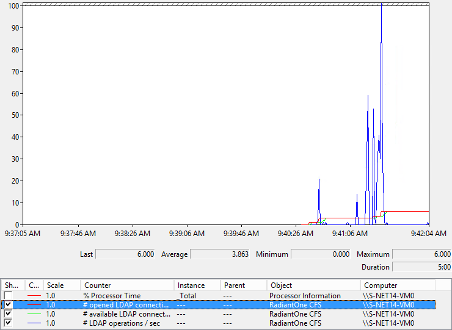
