# Active Directory Password Synchronization for Self-Managed Deployments

## Overview

This guide describes how to configure Active Directory (AD) password hash retrieval and synchronization in self-managed RadiantOne Identity Data Management v9 deployments on Kubernetes that do not use Secure Data Connector (SDC).

Identity Data Management provides this capability through AD Password Sync, a built-in identity feature that connects on-premises AD environments with Microsoft Entra ID. For AD password operations, it uses two components:

- **AD Password Sync Service**: An in-cluster component that runs alongside Identity Data Management and routes requests between Identity Data Management and the on-premises agents.
- **AD Password Sync Client**: A lightweight Windows service that you install on a domain-joined host in your AD forest. The client communicates with domain controllers to perform password hash and directory operations.

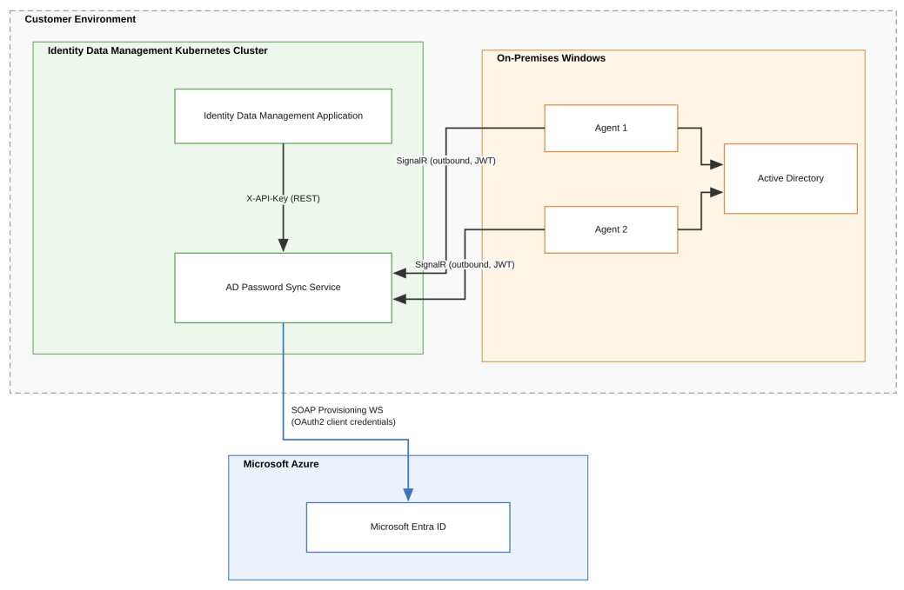

The client opens an outbound-only connection to the Sync Service over HTTPS/WebSockets using SignalR, so you don't need to open any inbound firewall ports on the on-premises network. Through this connection, Identity Data Management requests password hash operations, and the client performs them using RPC and the Active Directory Replication Service (DRS) protocol. Supported password data includes NT hashes (MD4), Microsoft Entra ID PBKDF2 hashes, and password hash history.

Inside the cluster, Identity Data Management calls the Sync Service over REST and authenticates with an API key (`X-API-Key`). To synchronize users and password hashes to Microsoft Entra ID, the Sync Service calls the Entra ID SOAP provisioning web service and authenticates with OAuth2 client credentials. You can connect more than one agent to the same forest. Each agent connects to the Sync Service independently, which gives you failover.

Administrators use the AD Password Sync section of the Control Panel to organize agents into forest-specific groups, register and monitor agents, and bind AD data sources to agent groups. Identity Data Management automatically renews agent tokens while agents are connected.

>[!note]
>AD Password Sync retrieves password hashes. It does not capture plain-text passwords, and it is separate from the legacy password filter and from sync pipelines.

## Prerequisites

Ensure that you have the following requirements in place:

- RadiantOne Identity Data Management v9.1.0 (or later) deployed in a self-managed Kubernetes cluster using the `iddm-helm` chart. The FID image tag (or chart `appVersion`) must be 9.0 or later. If you pin an 8.x image, the chart leaves out the Sync Service without showing an error.
- On-premises Active Directory environment (domain controllers that the Windows Agent can reach).
- Ingress Controller with:
  - TLS termination enabled with a trusted certificate (or an enterprise CA certificate that the Windows host trusts).
  - WebSocket upgrade support for persistent SignalR connections.
  - Path routing enabled for `/adentra-sync`.
  - A Kubernetes TLS secret that contains the Ingress certificate. The Helm chart does not create this secret (see Step 1).
  - A DNS name for the Ingress (for example, `adentra.example.com`) that the Windows host can resolve.
- Windows Host for AD Password Sync Client:
  - Windows Server 2016+ or Windows 10/11 joined to the Active Directory domain/forest.
  - .NET 8 Runtime installed on the Windows host.
  - Domain account permissions to execute AD password and replication operations (DRS/SAM).
  - Local administrator rights to install the Windows service and import certificates.
- Network and Firewall Connectivity:
  - **Agent to Identity Data Management Ingress**: Outbound HTTPS (port 443) from the Windows Agent to the Identity Data Management Ingress base URL (`/adentra-sync/activedirectoryhub`). You don't need to open any inbound firewall ports into the on-premises network.
  - **Agent to Domain Controllers**: RPC port 135 (TCP/UDP) and ephemeral RPC ports (49152–65535 TCP/UDP).
  - **FID to Domain Controllers**: LDAPS (port 636) or LDAP (port 389).
  - **Sync Service to Microsoft Entra ID**: Outbound HTTPS (port 443) from the Kubernetes cluster to the Entra ID SOAP provisioning web service, using OAuth2 client credentials. You need this only if you synchronize to Entra ID.

## Steps for Configuration

The following table summarizes the configuration steps and where you perform each one.

| Step | Where | What you do |
| :--- | :--- | :--- |
| 1 | Kubernetes | Create the Ingress TLS secret |
| 2 | Kubernetes | Enable AD Password Sync in the Helm configuration |
| 3 | Control Panel | Configure on-premises AD as a data source |
| 4 | Control Panel | Create an AD proxy and computed attributes |
| 5 | Control Panel | Create an agent group |
| 6 | Control Panel | Register an agent and obtain the agent token |
| 7 | Windows host | Install and start the AD Password Sync Client |
| 8 | Control Panel | Bind the AD data source to the agent group |
| 9 | Control Panel | Verify the configuration |

### 1. Create the Ingress TLS Secret

The Windows Agent connects to the Sync Service over HTTPS, so the Ingress needs a certificate whose Subject Alternative Name (SAN) matches the external Ingress host name. The Helm chart does not create this secret, so you must create it before you deploy.

1. Obtain a certificate and private key for your external Ingress host from your enterprise or public CA.
2. Create the TLS secret in the Identity Data Management namespace:

   ```bash
   kubectl -n <namespace> create secret tls adentra-sync-tls \
     --cert=adentra-sync.crt \
     --key=adentra-sync.key
   ```

3. Verify that the secret exists:

   ```bash
   kubectl -n <namespace> get secret adentra-sync-tls
   ```

   >[!note]
   >For test environments only, you can generate a self-signed certificate with the following command. If you use a self-signed certificate, you must also import it into the trust store on the Windows host (Step 8).

   ```bash
   export ADENTRA_HOST=<external-ingress-host>
   openssl req -x509 -nodes -days 365 -newkey rsa:2048 \
     -keyout adentra-sync.key -out adentra-sync.crt \
     -subj "/CN=${ADENTRA_HOST}" \
     -addext "subjectAltName=DNS:${ADENTRA_HOST}" \
     -addext "extendedKeyUsage=serverAuth"
   ```

### 2. Enable AD Password Sync in Identity Data Management Helm Configuration

Identity Data Management includes the AD Password Sync Service. AD Password Sync and the Ingress are both disabled by default, and you enable them through Helm values.

1. In your `values.yaml` file for the Identity Data Management Helm deployment, enable `adentraSync`, define the public JWT issuer URL, and configure the Ingress:

   ```yaml
   adentraSync:
     enabled: true
     replicas: 1          # Must be 1. Connection state is held in memory.
     jwt:
       issuer: https://<external-ingress-host>/adentra-sync
     ingress:
       enabled: true
       ingressClassName: nginx        # Must match: kubectl get ingressclass
       annotations:
         nginx.ingress.kubernetes.io/proxy-read-timeout: "3600"
         nginx.ingress.kubernetes.io/proxy-send-timeout: "3600"
       hosts:
         - host: <external-ingress-host>
           paths:
             - /adentra-sync
       tls:
         - secretName: adentra-sync-tls
           hosts:
             - <external-ingress-host>
   ```

   The following table describes what each value does:

   | Value | Description |
   | :--- | :--- |
   | `adentraSync.enabled` | Deploys the Sync Service, its Kubernetes Service, and generated secrets, and adds the `/adentra-sync` route to the iddm-proxy (HAProxy). |
   | `adentraSync.replicas` | Must be 1. The chart fails to render with a higher value. |
   | `adentraSync.jwt.issuer` | The public HTTPS URL that the Windows Agents use to reach the Sync Service. The client derives the SignalR hub URL from the JWT `iss` claim, so this value must exactly match the externally reachable URL. If you leave it out, the chart builds it from the first Ingress host that has a TLS entry, but setting it explicitly is safer. |
   | `ingress.enabled` and `hosts` | The Ingress is the only way for agents to reach the cluster. |
   | `ingress.ingressClassName` | Must match your Ingress controller. |
   | `ingress.tls` | Points the Ingress to the certificate from Step 1. Without it, the endpoint is not HTTPS and the chart can't build the issuer URL. |
   | NGINX timeout annotations | Recommended. The NGINX default of 60 seconds closes idle SignalR connections after one minute. |

   You can also set the following optional values:

   - `adentraSync.apiKeySecretKey`: By default, the Sync Service shares the FID admin API key (`fid-admin-api-key`). Set this value (for example, to `adentra-api-key`) to give the Sync Service its own key.
   - `adentraSync.jwt.secretKey` and `adentraSync.apiKey`: If you leave these empty, the chart generates them once, stores them in the `rootcreds-fid` secret, and reuses them on upgrades. Set them explicitly only if you deploy with a GitOps tool such as Argo CD. Otherwise, each sync rotates the keys and disconnects every agent.

   You don't need to configure the proxy route yourself. When you enable AD Password Sync, the chart adds the `/adentra-sync` route, strips the path prefix, and sets a 3600-second WebSocket timeout on HAProxy.

2. Deploy or upgrade the Helm release:

   ```bash
   helm upgrade --install fid oci://registry-1.docker.io/radiantone/iddm-helm \
     --version 9.1.0 \
     -n <namespace> -f values.yaml --timeout=30m --wait
   ```

3. Verify that the Sync Service is running and that the health endpoint returns `Healthy`:

   ```bash
   curl --fail --cacert adentra-sync.crt https://<external-ingress-host>/adentra-sync/health
   ```

   You can also run the built-in Helm test:

   ```bash
   helm test fid -n <namespace> --filter name=iddm-test-adentra --logs
   ```

### 3. Configure On-Premises AD as a Data Source

Configure your Active Directory domain controller as a backend LDAP data source in RadiantOne:

1. Navigate to **Control Panel > Setup > Data Catalog > Data Sources**.
2. Click **New Source** and select **Active Directory**.
3. Fill in the connection settings:
   - **Host**: Hostname or IP address of the domain controller.
   - **Port**: 636 for LDAPS (recommended) or 389 for LDAP.
   - **SSL/TLS**: Enable if using LDAPS. Ensure that the DC's enterprise CA is imported into the FID trust store.
   - **Bind DN / Password**: Credentials for an account with access to read directory objects.
4. Test the connection and save the data source (for example, named `ad_source`).

### 4. Create an AD Proxy and Computed Attributes

Expose the Active Directory users through a virtual proxy namespace and add the password computation functions.

1. Navigate to **Directory Namespace > Namespace Design**.
2. Create a new proxy naming context that points to the AD data source (for example, `o=adproxy`, naming context type LDAP_PROXY).
3. Open **Object Builder** for the proxy node and select `user` as the primary object class.
4. Open the **Computed Attributes** panel, click **Add**, and create an attribute for each function:

   | Example name | Expression | Returns |
   | :--- | :--- | :--- |
   | adpwd | `getADPassword()` | The Microsoft Entra ID OrgId PBKDF2 hash blob (for example, `{PBKDF2AD}v1;PPH1_MD4,...`). |
   | adpwdmd4 | `getADPasswordMD4()` | The standard Active Directory NT hash in MD4 format (for example, `{MD4}...`). |
   | adpwdhist | `getADPasswordHistory()` | The historical password hash entries for the account. |

5. Ensure that each attribute is marked **Active**, click **Validate All**, and then click **Save**.

   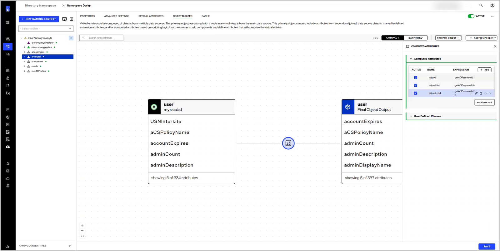

   >[!note]
   >These attributes stay empty until an agent is connected and you bind the data source to its agent group (Steps 6–9). This is expected.

### 5. Create an Agent Group

Agent groups represent an Active Directory forest. An agent group acts as a failover pool: Identity Data Management routes password operations for the forest to any connected agent in the group. To make a forest highly available, register more than one agent in the same group.

1. In the Identity Data Management Control Panel navigation, go to **AD Password Sync > Agents & Groups**.

   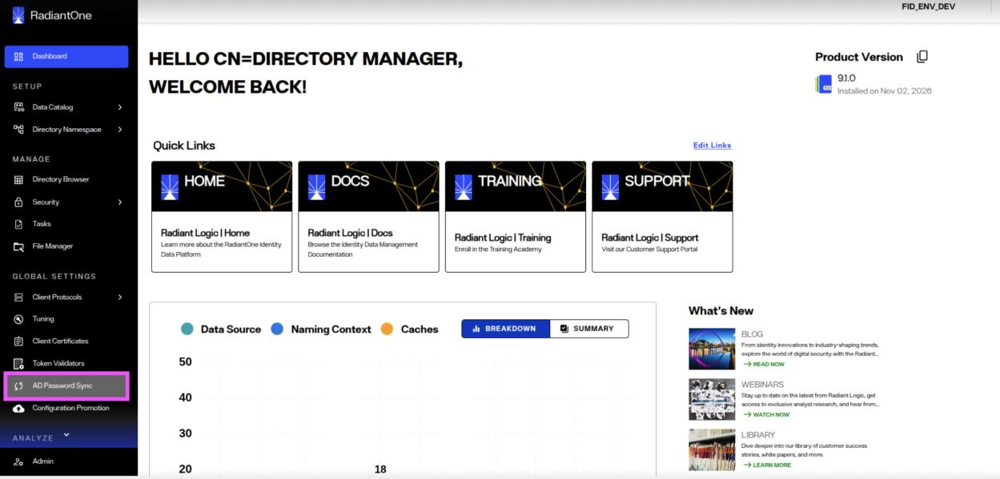

2. Click **Create Agent Group**.
3. Enter a **Display Name** that identifies your forest (for example, `corp-forest-group`).
4. (Optional) Enter the **AD Forest** name.
5. Click **Save**.

   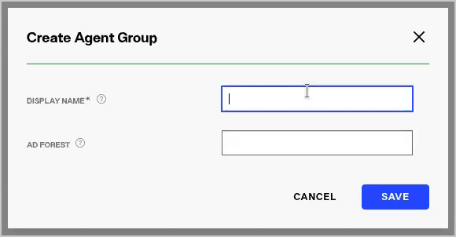

   >[!warning]
   >**Important:** You can't edit or remove agent groups after you create them, because agents and data source bindings reference the group by its ID. Choose the name carefully.

### 6. Register an Agent and Obtain the Agent Token

1. On the **Agents & Groups** page, click **Register Agent**.
2. Select the **Agent Group** that you created in Step 6.
3. Enter a **Display Name** for the agent (for example, `agent-dc01`).
4. Click **Save**. The **Agent Access Token** dialog opens.

   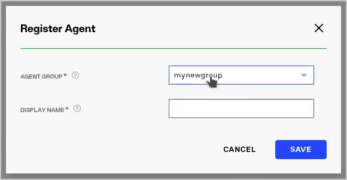

5. **Copy the generated access token.** The token is a signed JWT that embeds the agent ID, the group ID, and the `iss` endpoint URL.

   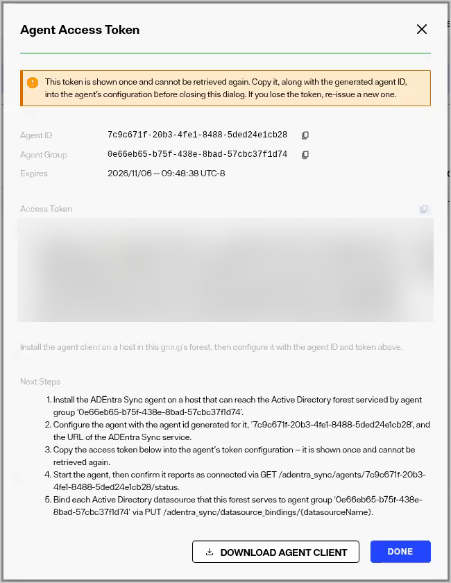

   >[!warning]
   >**Important:** The dialog shows the token only once, and you can't retrieve it later. If you lose the token, use **Re-issue Token** to create a new one (see [Managing Agents](#managing-agents)).

   >[!note]
   >Tokens are valid for 30 days. For details about renewal, see Token Lifecycle.

6. If you don't have the client package yet, click **Download Agent Client**. You can also download it at any time from the **Download Agent Client** button on the **Agents & Groups** page.
7. Click **Done**.

The new agent appears in the list with the status **Disconnected** until you start the client.

### 7. Install and Start the AD Password Sync Client (Windows Agent)

Install the client on a domain-joined Windows Server (or directly on a domain controller) that can reach domain controllers over RPC. Run the following commands in an Administrator PowerShell window.

1. Copy the client package (`ad-password-sync-client_1.0.0.zip`) to the Windows host, and verify it:
   1. On the **Agents & Groups** page, click the copy icon next to the **SHA-256** checksum, below **Download Agent Client**.

      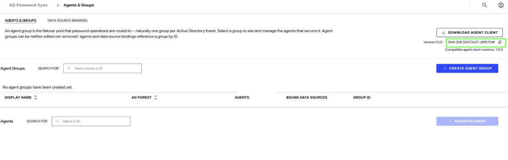

   2. On the Windows host, generate the SHA-256 checksum of the client package, and compare it with the checksum that you copied. If the two values don't match, don't install the client package.
   3. Extract the client package (for example, to `C:\RadiantLogic\ADEntraSyncClient`).
2. Verify that the Windows host can reach the Ingress:
   - If the Ingress host name is not in DNS, add it to `C:\Windows\System32\drivers\etc\hosts`. Use the Ingress (load balancer) address, not a Kubernetes Service IP.
   - Flush the DNS cache, and confirm that the host name resolves and that port 443 is reachable:

     ```powershell
     ipconfig /flushdns
     [System.Net.Dns]::GetHostAddresses("<external-ingress-host>")
     Test-NetConnection <external-ingress-host> -Port 443
     ```

3. Configure TLS trust. If your Identity Data Management Ingress uses an internal, private, or self-signed certificate, import the root/issuing CA into the Windows **Local Machine** certificate store. The Current User store and browser trust are not enough for a Windows service.

   ```powershell
   Import-Certificate -FilePath "C:\path\to\rootCA.crt" -CertStoreLocation "Cert:\LocalMachine\Root"
   ```

4. Configure the agent token. The client reads its connection settings from the `ServerConnection` section of `appsettings.json`:

   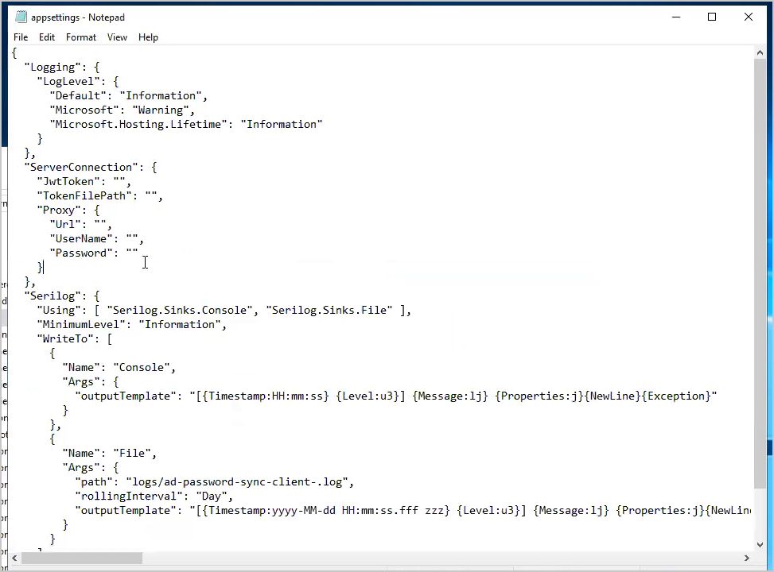

   - **JwtToken**: The access token from Step 7, pasted directly into the file.
   - **TokenFilePath**: The path to a file that contains the token. If you don't set it, the client uses `%ProgramData%\RadiantLogic\ADEntraSyncClient\adentra-sync-agent-token.txt`.
   - **Proxy** (Url, UserName, Password): Optional proxy settings. Add or modify proxy settings if your environment requires a proxy.

   Provide the token using one of the following methods:

   - **Token file**: The client writes renewed tokens to this file, so the token persists across service restarts. Create the default token directory and write the copied JWT into the file:

     ```powershell
     $tokenPath = "$env:ProgramData\RadiantLogic\ADEntraSyncClient\adentra-sync-agent-token.txt"
     New-Item -ItemType Directory -Force -Path (Split-Path $tokenPath)
     Set-Content -Path $tokenPath -Value "<paste-access-token-here>" -NoNewline
     ```

   - **Inline**: Paste the token as the value of `JwtToken` in `appsettings.json` and save the file.

5. Install and start the Windows service:

   ```powershell
   cd C:\RadiantLogic\ADEntraSyncClient
   .\ADEntraSyncClient.exe --install-service
   Start-Service ADEntraSyncClient
   ```

The client reads the `iss` claim from the JWT, connects through an outbound WebSocket to `/adentra-sync/activedirectoryhub`, and registers with the Sync Service.

>[!note]
>**Tip:** To test the connection before you install the service, run `.\ADEntraSyncClient.exe` from the command prompt. The client logs to the console.

The client writes its logs to the `logs` folder in the client directory (`logs\ad-password-sync-client-<date>.log`) and starts a new file each day.

### 8. Bind the AD Data Source to the Agent Group

A binding tells RadiantOne which agent group handles password operations for a data source.

1. Return to the Identity Data Management Control Panel under **AD Password Sync**.
2. Navigate to the **Data Source Bindings** tab and click **Bind Data Source**.
3. Select your Active Directory **Data Source** (created in Step 4).
4. Select your **Agent Group** (created in Step 6).
5. Click **Save**. FID now routes all password hash operations for this data source to the connected agents in the group.

   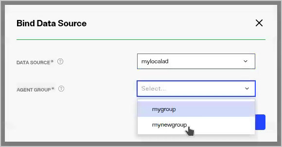

   >[!note]
   >Each data source is serviced by exactly one agent group. If you bind a data source again, the new binding replaces the previous group. Until a binding exists, AD password operations for that data source fall back to the legacy path.

### 9. Verify the Configuration

Verify that the agent is connected and that password hashes are retrieved live.

**Agent connection check**

1. In **AD Password Sync > Agents & Groups**, select your agent group.
2. Confirm that the agent status displays **Connected**.

   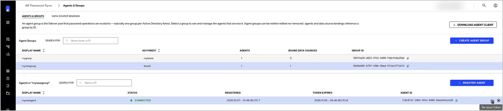

You can also follow the Sync Service log to watch the agent connect:

```bash
kubectl -n <namespace> logs deployment/adentra-sync --follow
```

**Password attribute check**

1. Navigate to **Directory Browser** in the Identity Data Management Control Panel.
2. Browse to a user under the AD proxy naming context (for example, `CN=user01,CN=Users,o=adproxy`).
3. Confirm that the computed attributes mapped to `getADPassword()`, `getADPasswordMD4()`, and `getADPasswordHistory()` are populated with hash values.

   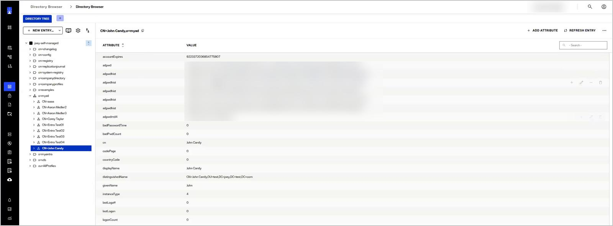

**Live verification**

1. Reset or change the user's password directly in Active Directory.
2. Click **Refresh Entry** in Directory Browser.
3. Confirm that the MD4 and PBKDF2 attributes update to reflect the new password hash, and that the password history attribute records the previous password hash.

   >[!note]
   >**Tip:** If you temporarily stop the `ADEntraSyncClient` Windows service, the password attributes disappear while base directory attributes remain accessible. This confirms that Identity Data Management resolves the values live through the agent.

## Managing Agents

Each agent row on the **Agents & Groups** page shows the agent's status, registration date, token expiration, and agent ID. The agent status can be one of the following:

- **Connected**: The client is running and connected to the Sync Service.
- **Disconnected**: The agent is registered, but the client is not connected (for example, the client is not started, is stopped, or can't reach the Ingress).
- **Deactivated**: An administrator deactivated the agent, and it no longer receives password operations.

Use the icons at the end of each agent row to manage the agent.

### Re-issue Token

Access tokens are valid for 30 days from issue. The **Token Expires** column shows the expiration date.

While an agent is connected, Identity Data Management automatically renews its token before it expires and sends the new token to the client. If the token expires while the agent is offline, the agent can't reconnect.

Use **Re-issue Token** to generate a replacement access token if you lose the original token or it expires while the agent is offline. This action doesn't invalidate existing tokens. The dialog displays the new token only once. Copy it into the client configuration (Step 8), then restart the sync client.

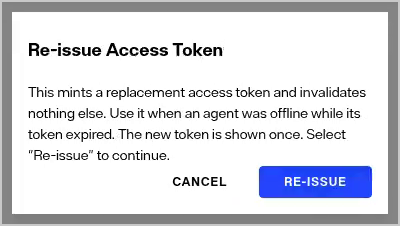

### Deactivate

**Deactivate** drops the agent's connection to the Sync Service and stops routing password operations to it.

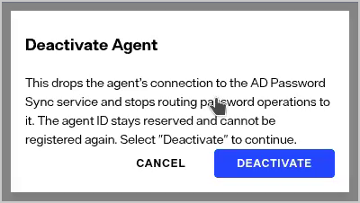

>[!warning]
>**Important:** Deactivation is permanent. The agent ID stays reserved and can't be registered again. To replace a deactivated agent, register a new agent.

## Troubleshooting

Check the following logs when something goes wrong:

- **AD Password Sync Service**: `kubectl -n <namespace> logs deployment/adentra-sync`
- **AD Password Sync Client**: `logs\ad-password-sync-client-<date>.log` in the client folder, or the console if you run the client interactively.
- **FID**: `kubectl -n <namespace> logs fid-0 -c fid`

The following table lists common issues and how to resolve them.

| Symptom | Cause and resolution |
| :--- | :--- |
| Client error: No such host is known | The host name doesn't resolve on the Windows host. Add a DNS record or a hosts file entry (Step 8). |
| Client error: Certificate validation failed | The certificate SAN doesn't match the host name, or the CA is not in `Cert:\LocalMachine\Root` (Step 8). |
| HTTP 404 from the agent | The URL is missing `/adentra-sync`. Check `adentraSync.jwt.issuer`, and then re-issue the token. |
| HTTP 404 in FID calls to the Sync Service | Check `syncServiceUrl` (Step 3), and check the Sync Service log for the requested path. |
| HTTP 502 / 503 | Check that the `adentra-sync` pod is running and that its Kubernetes Service has endpoints. |
| Health check works, but SignalR connections drop | Check that `jwt.issuer` exactly matches the external URL, check the firewall, and set the NGINX proxy timeouts to 3600 (Step 2). |
| The Ingress serves the "Kubernetes Ingress Controller Fake Certificate" | The TLS secret is missing, is in the wrong namespace, or has the wrong SAN. Helm still installs without an error. Check which certificate the Ingress serves with `openssl s_client -connect <ingress-ip>:443 -servername <external-ingress-host>`. |
| The Sync Service isn't deployed | The FID image tag is earlier than 9.0, or `adentraSync.enabled` is not `true`. |
| All agents disconnect after an Argo CD sync | The chart regenerated the keys. Set `adentraSync.jwt.secretKey` and `adentraSync.apiKey` explicitly (Step 2), and then re-issue the tokens. |
