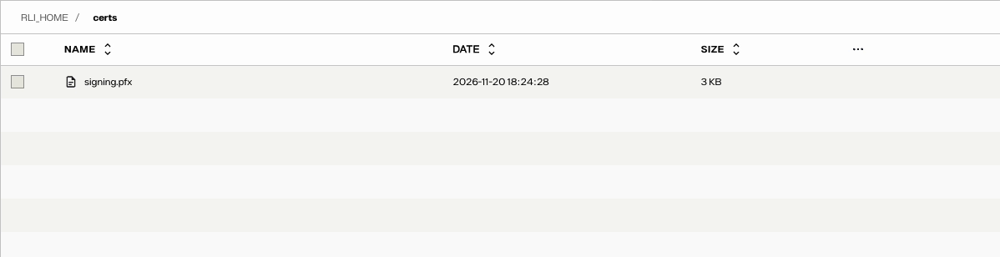
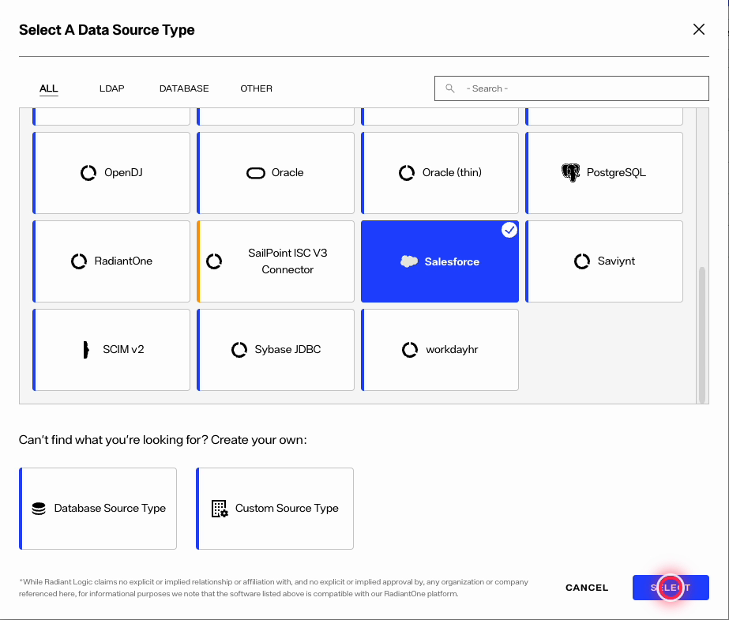
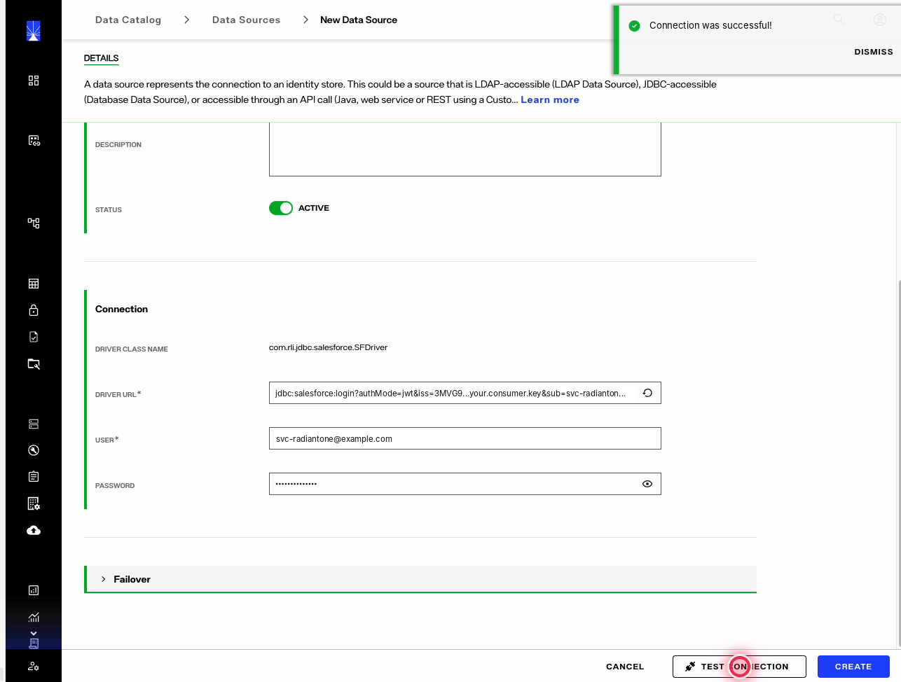
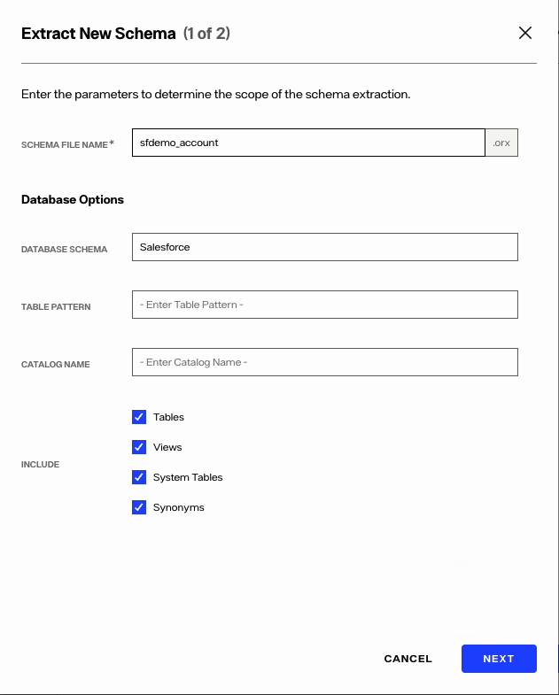
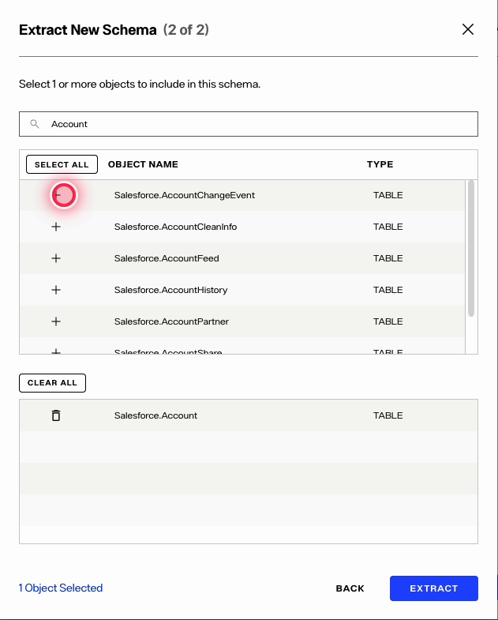
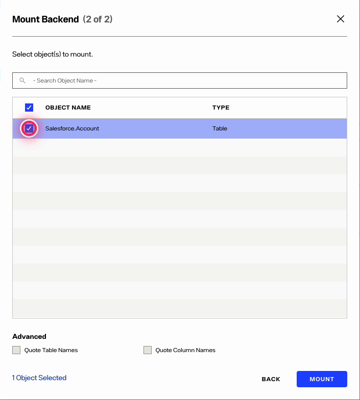
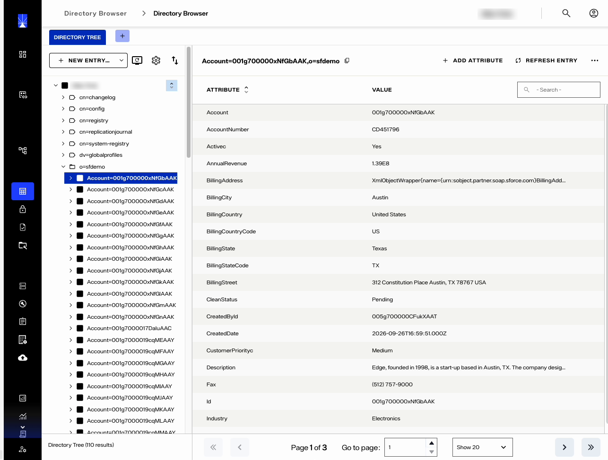

# Connect RadiantOne Identity to Salesforce

Connect RadiantOne Identity Data Management to Salesforce to query Salesforce data and display the results as directory entries. This guide uses OAuth 2.0 JWT Bearer authentication, which does not require a Salesforce password or interactive login.

Starting with Identity Data Management 9.1.0, the Salesforce JDBC driver can sign a JWT assertion using a private key on the Identity Data Management host and exchange the assertion for an access token.

Configure Salesforce first, then configure Identity Data Management using the values collected from Salesforce. Username and password authentication (`basic` mode) remains the default. Switching to JWT Bearer authentication does not change queries, schemas, or mounts.

>[!note]
>The instructions in this document apply to RadiantOne Identity Data Management 9.1.0 and later.

## Login method deprecation

Salesforce is retiring the SOAP `login()` call traditionally used by Salesforce JDBC data sources.

| Salesforce org or API version | Impact |
|---|---|
| Org created before approximately mid-2026 | SOAP `login()` remains available until Summer ’27. Plan to migrate before retirement. |
| Recently created org | SOAP `login()` is disabled by default. Configure JWT Bearer authentication to connect without re-enabling it. |
| API version 65.0 or later | SOAP `login()` is unavailable. |

An org with SOAP login disabled returns:

```
INVALID_OPERATION: SOAP API login() is disabled by default in this org
```

Re-enabling SOAP login requires both an org-level setting and the **Use Any API Auth** user permission. Neither allows access by default, and the permission is not granted automatically to System Administrators. Configure JWT Bearer authentication rather than re-enabling a retiring authentication method.

## Prerequisites

You need:

- A Salesforce System Administrator to configure the app, integration user, and permissions.
- An Identity Data Management administrator to configure the data source and directory mount.
- Access to the Identity Data Management host or its File Manager to upload the keystore.
- `keytool`, included with a JDK, on the machine where you generate the signing key pair.

## Configure Salesforce

### Step 1: Generate the signing key pair

Run this step on a workstation or server, not in Salesforce. You will create:

- A keystore containing the private key used by Identity Data Management.
- A certificate containing the public key uploaded to Salesforce.

>[!warning]
> Generate the key pair outside Salesforce. A certificate created in Salesforce under Certificate and Key Management does not provide the private key that Identity Data Management needs to sign JWT assertions.

Set a restrictive `umask`, then generate the keystore:

```sh
umask 077
keytool -genkeypair \
  -alias salesforce-jwt \
  -keyalg RSA -keysize 2048 \
  -validity 730 \
  -storetype PKCS12 \
  -keystore salesforce-jwt.pfx \
  -dname "CN=RadiantOne Salesforce Integration, O=Example Corp, C=US"
```

When prompted, enter a keystore password. Record it securely; you will enter it in Identity Data Management in Step 9. The password cannot be recovered from the keystore.

>[!note]
> `.pfx` and `.p12` files use the same PKCS#12 format. The driver ignores the filename extension, but the Identity Data Management File Manager accepts `.pfx`, `.pkcs12`, and `.jks`, not `.p12`. If you already have a `.p12` file, rename it to `.pfx` before uploading it.

Export the public certificate:

```sh
keytool -exportcert -rfc \
  -alias salesforce-jwt \
  -keystore salesforce-jwt.pfx \
  -storetype PKCS12 \
  -file salesforce-jwt.crt
```

Choose the certificate validity period according to your security policy and rotation process. The example uses 730 days. Authentication fails when the certificate expires, so record the expiration date in a system that generates alerts. See [Rotate the certificate](#rotate-the-certificate).

Also record the key alias, `salesforce-jwt` in this example. To retrieve the alias later, run:

```sh
keytool -list -keystore salesforce-jwt.pfx -storetype PKCS12
```

### Step 2: Create the connected app

In Salesforce Setup, go to **App Manager** → **New Connected App** → **Create a Connected App**.

>[!note]
> If your org offers only **New External Client App**, see [Use an External Client App](#use-an-external-client-app). The authentication values are the same, but some settings appear in different locations.

Configure the app:

1. Enter a **Connected App Name**, such as `RadiantOne Integration`. Choose a recognizable name because it appears in **Login History**.
2. Enter a **Contact Email**.
3. Select **Enable OAuth Settings**.
4. Set **Callback URL** to `http://localhost:1717/OauthRedirect`. The form requires a value, but JWT Bearer authentication does not use a browser redirect.
5. Select **Use digital signatures** and upload `salesforce-jwt.crt` from Step 1.
6. Add both OAuth scopes:
   - **Manage user data via APIs (api)**
   - **Perform requests at any time (refresh_token, offline_access)**
7. Click **Save** and allow several minutes for the changes to propagate.

>[!note]
> Both scopes are required for this configuration. Although JWT Bearer authentication does not issue a refresh token, Salesforce uses prior approvals that include the refresh-token scope when authorizing the grant. Without that scope, requests fail with:
>
> ```
> invalid_request: refresh_token scope is required and the connected app should be installed and preauthorized
> ```
>
> Keep the `api` scope as well. Token issuance requires at least one standard scope other than `refresh_token`.

### Step 3: Pre-authorize the app

Go to **App Manager** → the app’s dropdown → **Manage** → **Edit Policies**.

1. Set **Permitted Users** to **Admin approved users are pre-authorized**.
2. Set **Start URL** to `/lightning`. The form requires a value, but this flow does not use it.
3. Click **Save**.

The default policy, **All users may self-authorize**, relies on interactive consent and is not suitable for this unattended configuration.

### Step 4: Create the integration user

Identity Data Management receives an access token with the permissions of a Salesforce user. Create a dedicated integration user with only the permissions the integration requires. Do not use an administrator account or an individual’s account.

Go to **Setup** → **Users** → **New User** and configure:

| Setting | Value | Purpose |
|---|---|---|
| Role | **None** | Avoids granting unnecessary visibility through the role hierarchy. |
| User License | **Salesforce** | Supports objects such as Opportunity, Lead, Case, and Campaign that are excluded by a Salesforce Platform license. |
| Profile | **Minimum Access - Salesforce** | Provides a minimal baseline. Grant additional access through a permission set. |

After creating the user, record the value in the **Username** column under **Setup** → **Users**.

>[!note]
> Use the Salesforce username, not an assumed email address. Salesforce usernames are globally unique and may differ from the user’s email address. An incorrect username can produce the same error as missing app pre-authorization.

### Step 5: Create and assign a permission set

Create a permission set with:

- **API Enabled**.
- The object and field permissions required by the data source.
- **View Setup and Configuration**, only if the data source reads Setup objects such as `FieldPermissions`.

>[!note]
> Without **API Enabled**, the token exchange can succeed while subsequent queries fail. A successful token exchange does not confirm that the user has API access.

>[!note]
> Grant **View Setup and Configuration** only when needed. It increases the number of objects Salesforce exposes and the metadata the driver caches on first use. Without it, queries for Setup objects can return:
>
> ```
> INVALID_TYPE: sObject type 'FieldPermissions' is not supported
> ```

Associate the permission set with both the user and the app:

1. Assign it to the integration user under **Setup** → **Users** → the user → **Permission Set Assignments**.
2. Associate it with the connected app under **App Manager** → the app → **Manage** → **Manage Permission Sets**.

If either association is missing, authentication can fail with:

```
invalid_grant: user hasn't approved this consumer
```

### Step 6: Collect the Salesforce connection values

Record these values before continuing:

| Value | Location | Identity Data Management setting |
|---|---|---|
| **Consumer Key** | **App Manager** → the app’s dropdown → **View**, or **Manage Consumer Details** | `iss` |
| Integration user’s **Username** | **Setup** → **Users** → **Username** column | `sub` |
| **My Domain** enforcement status and login URL | **Setup** → **My Domain** | `tokenHost`, if required |

The Consumer Secret is not required. JWT Bearer authentication uses the private key instead of a client secret.

## Configure Identity Data Management

### Step 7: Install the keystore

The driver reads the keystore directly from the Identity Data Management host. You do not import it into a certificate store.

>[!warning]
> Do not import the keystore into the **Client Certificate Truststore**. That truststore accepts individual X.509 certificates, not PKCS#12 keystores, and the Salesforce driver does not use it. Attempting an import produces an error such as:
>
> ```
> Certificate <name> is invalid and cannot be imported. Reason: signed fields invalid
> ```

Place the keystore in `$RLI_HOME/certs`. Files in this directory are replicated across the cluster, making the keystore available at the same path on every node. The `keystore` URL parameter is cluster-wide, so the path must be identical across nodes.

Use either the File Manager or a shell.

#### Upload with the File Manager

In the Control Panel:

1. Open **File Manager**.
2. Navigate to `certs`.
3. Click **Upload File**.
4. Upload `salesforce-jwt.pfx`.



The upload preserves the file contents.

>[!warning]
> Uploading a file replaces an existing file with the same name without warning. When rotating the key, use a new filename rather than overwriting the current keystore.

#### Install with a shell

```sh
install -m 600 -o radiantone -g radiantone \
  salesforce-jwt.pfx /opt/radiantone/vds/certs/salesforce-jwt.pfx
```

Adjust the path, owner, and group for your installation.

#### Restrict file access

In a default installation, `$RLI_HOME/certs` is world-writable, and files uploaded through the File Manager are world-readable. Ensure that the keystore is owned by the RadiantOne service account and restrict its permissions:

```sh
chmod 600 /opt/radiantone/vds/certs/salesforce-jwt.pfx
```

The file mode is replicated with the file, so apply this change once for the cluster.

If you store the keystore outside `$RLI_HOME/certs`, place it at the same absolute path on every node. Files outside that directory are not replicated automatically.

After installation:

- Delete the copy on the machine that generated the key. It is the private key, and a staging copy is as good as the original.
- Nodes added to the cluster receive the keystore through replication when it is stored in `$RLI_HOME/certs`.

>[!note]
> For container deployments, ensure that the keystore is on persistent storage. `$RLI_HOME/certs` is within the persistent `$RLI_HOME` volume. A file stored outside persistent storage can disappear when the pod is replaced.

### Step 8: Create or open the data source

Go to **Data Catalog** → **Data Sources**.

- To create a data source, click **New Source** and select **Salesforce**.
- To update an existing Salesforce data source, open it.



Use the Salesforce data source type rather than a generic type so that the catalog identifies the connection correctly.

### Step 9: Configure the connection

Configure the **Driver URL**, **Password**, and **User** fields.

#### Driver URL

Add JWT parameters after `?`, separated by `&`. Enter the URL on one line:

```properties
jdbc:salesforce:login?authMode=jwt&iss=3MVG9...your.consumer.key&sub=svc-radiantone@example.com&aud=https%3A%2F%2Flogin.salesforce.com&keystore=%2Fopt%2Fradiantone%2Fvds%2Fcerts%2Fsalesforce-jwt.pfx&keystoreAlias=salesforce-jwt
```

Replace:

- `iss` with the app’s Consumer Key.
- `sub` with the integration user’s Salesforce username.
- `keystore` with the absolute path to the installed keystore.
- `keystoreAlias` with the signing-key alias.

For sandbox and My Domain configurations, see [JDBC URL reference](#jdbc-url-reference).

#### Password

Enter the keystore password from Step 1, not the Salesforce account password.

Identity Data Management encrypts this field. The driver accepts the keystore password only through this field and rejects passwords supplied in the URL.

#### User

Enter the same username used in `sub`.

The form requires this field, but the driver uses `sub` to identify the user in JWT mode. Keeping the values consistent avoids confusion.

Save the data source. For a new data source, click **Create**.

### Step 10: Test the connection

Click **Test Connection**.



A successful test confirms that Identity Data Management signed a JWT assertion, exchanged it for an access token, and connected to Salesforce. It does not verify the complete directory access path. Complete Steps 11 and 12 for that validation.

If the test fails, the interface displays the generic message:

```
Unable to connect to db
```

Check these settings first:

1. Username: Confirm that `sub` exactly matches the **Username** value under Salesforce **Setup** → **Users**.
2. Pre-authorization: Confirm that **Permitted Users** is set to **Admin approved users are pre-authorized** and that the permission set is associated with both the user and the app.
3. OAuth scopes: Confirm that both `api` and **Perform requests at any time** are selected.
4. Keystore: Verify the file path, alias, and keystore password.
5. Audience and endpoint: Use the production audience for production or the sandbox audience for a sandbox. Set `tokenHost` if the org enforces My Domain.

For detailed errors, review the RadiantOne server log on the node that attempted the connection. See [Troubleshooting](#troubleshooting). Include the relevant log entries when contacting Radiant Logic Support.

### Step 11: Mount the data source as a naming context

Mounting is the same for JWT and basic authentication. This step creates the directory path used for end-to-end verification.

1. Go to **Directory Namespace** → **Namespace Design**.
2. Click **New Naming Context**.
3. Enter an RDN, such as `o=salesforce`.
4. Select the naming context.
5. Click **Mount Backend** → **Database**.

#### Extract the schema

The mount wizard requires a **Data Source** and a **Data Source Schema** file. If no schema has been extracted, it displays:

```
No schema detected. Schema must be extracted before an object can be selected.
```

To extract the schema:

1. Click **Extract Schema**.
2. Set **Database Schema** to `Salesforce`.
3. Leave **Catalog Name** empty.
4. Continue to the object-selection screen.
5. Search for and select the required objects.
6. Click **Extract**.





>[!note]
> **Table Pattern** does not filter the object list. Use the search box on the object-selection screen instead.

Schema extraction calls Salesforce once for each selected object. Select only the objects you need to reduce extraction time.

#### Complete the mount

Return to the mount wizard:

1. Select the extracted schema file.
2. Click **Next**.
3. Select the objects to mount.
4. Leave **Quote Table Names** and **Quote Column Names** unselected. SOQL does not support quoted identifiers.
5. Click **Mount**.



The resulting tree has the type `Virtual Tree (Database)`.

### Step 12: Verify access in the Directory Browser

1. Go to **Manage** → **Directory Browser**.
2. Expand the naming context created in Step 11.
3. Expand a mounted object.
4. Select a record to inspect its attributes.



If records appear, the complete path is working: the driver authenticated, obtained an access token, queried Salesforce, and returned directory entries.

Each Salesforce record is represented as an entry identified by the object’s primary key, with an object class derived from the Salesforce object.

| Attribute | Example value |
|---|---|
| DN | `Account=001g700000xNfGbAAK,o=salesforce` |
| `objectclass` | `top`, `vdSalesforceAccount` |
| `Name` | `Edge Communications` |
| `Type` | `Customer - Direct` |
| `Industry` | `Electronics` |

The mount provides live access rather than copying or synchronizing records into Identity Data Management. Searches, including Directory Browser activity, reach Salesforce and count against the org’s API limits.

>[!note]
> Compound fields such as `BillingAddress` are returned as Java object representations rather than usable field values. Read the component fields instead: `BillingStreet`, `BillingCity`, `BillingState`, `BillingPostalCode`, and `BillingCountry`.

## JDBC URL reference

The driver rejects unrecognized parameters. A misspelled parameter causes a connection failure rather than being ignored.

| Parameter | Required | Default | Description |
|---|---|---|---|
| `authMode` | For JWT authentication | `basic` | Set to `jwt` or `basic`. An omitted or blank value uses `basic`. Other values cause an error. |
| `iss` | Yes | — | The app’s Consumer Key. |
| `sub` | Yes | — | The integration user’s Salesforce username. |
| `aud` | Yes | — | Audience for the JWT assertion: `https://login.salesforce.com` for production or `https://test.salesforce.com` for a sandbox. Specify it explicitly. |
| `keystore` | Yes | — | Absolute path to the keystore on each Identity Data Management host. |
| `keystoreAlias` | Except with PEM | — | Alias of the signing-key entry. Omit when `keystoreType=PEM`. |
| `keystoreType` | No | `PKCS12` | A JVM-supported keystore type, or `PEM` for an unencrypted PKCS#8 PEM private key. |
| `tokenHost` | No | Value of `aud` | Endpoint used for the token request. Set this when the org enforces My Domain. |

### Encode parameter values

The driver percent-decodes parameter values. It does not treat `+` as a space.

- Encode `:` as `%3A` and `/` as `%2F`.
- Encode any `&`, `=`, or `%` within a value.
- Leave `+` unchanged when it is part of a value. For example, `sub=svc+sf@example.com` identifies a username containing a literal plus sign.

### Audience and token endpoint

`aud` and `tokenHost` serve different purposes:

- `aud` specifies the audience in the signed JWT assertion.
- `tokenHost` specifies where the token request is sent.

They normally match. When My Domain is enforced, retain the appropriate production or sandbox audience and set `tokenHost` to the org’s My Domain login URL.

The driver validates both values against an allowlist of Salesforce domains: `salesforce.com`, `force.com`, `cloudforce.com`, and `salesforce.mil`. This prevents a signed assertion from being sent to an unrelated HTTPS endpoint.

### URL examples

Enter each URL on one line.

#### Production

```properties
jdbc:salesforce:login?authMode=jwt&iss=3MVG9...your.consumer.key&sub=svc-radiantone@example.com&aud=https%3A%2F%2Flogin.salesforce.com&keystore=%2Fopt%2Fradiantone%2Fvds%2Fcerts%2Fsalesforce-jwt.pfx&keystoreAlias=salesforce-jwt
```

#### Sandbox

Use `test` in the JDBC prefix, the sandbox audience, and the integration user’s sandbox username.

```properties
jdbc:salesforce:test?authMode=jwt&iss=3MVG9...your.consumer.key&sub=svc-radiantone@example.com.sandboxname&aud=https%3A%2F%2Ftest.salesforce.com&keystore=%2Fopt%2Fradiantone%2Fvds%2Fcerts%2Fsalesforce-jwt.pfx&keystoreAlias=salesforce-jwt
```

#### My Domain enforcement

```properties
jdbc:salesforce:login?authMode=jwt&iss=3MVG9...your.consumer.key&sub=svc-radiantone@example.com&aud=https%3A%2F%2Flogin.salesforce.com&tokenHost=https%3A%2F%2Fexample.my.salesforce.com&keystore=%2Fopt%2Fradiantone%2Fvds%2Fcerts%2Fsalesforce-jwt.pfx&keystoreAlias=salesforce-jwt
```

Use the org’s `<domain>.my.salesforce.com` login URL for `tokenHost`, not its `my.salesforce-setup.com` Setup URL.

### Use an External Client App

If **New Connected App** is unavailable, create an **External Client App**. The flow uses the same connection values, with these configuration differences:

| Connected app setting | External Client App equivalent |
|---|---|
| **Use digital signatures** in Step 2 | **Enable JWT Bearer Flow** under **Flow Enablement**; upload the certificate there. |
| **Manage** → **Edit Policies** in Step 3 | **Policies** tab |
| **Manage** → **Manage Permission Sets** in Step 5 | **Policies** tab |

The OAuth scopes, pre-authorization requirements, integration user, and Identity Data Management configuration remain the same.

If the consumer key resolves but the token request returns `app_not_found`, recreate the app. This error indicates that the definition was saved but the app was not installed in the org.

### Use a PEM private key

The driver also accepts an unencrypted PKCS#8 PEM private key. Set:

```properties
keystoreType=PEM
```

Omit `keystoreAlias`.

Prefer a keystore for these reasons:

- A PEM private-key file does not include the certificate, so the driver cannot report certificate expiration or issue expiration warnings.
- The private key is unencrypted on disk, so file access alone exposes the credential.

## Troubleshooting

Start with the server log. Test Connection displays `Unable to connect to db` for all connection failures, while LDAP access can report only `Cannot access backend`.

Find the driver’s diagnostics on the node that attempted the connection:

```
grep '\[SF JDBC\]' <RLI_HOME>/vds_server/logs/vds_server.log
```

Replace `<RLI_HOME>` with the installation path.

The driver adds guidance identifying the relevant setting or Salesforce Setup page.

| Error or symptom | Action |
|---|---|
| `invalid_request` with “refresh_token scope is required” | Add **Perform requests at any time (refresh_token, offline_access)**. Retain the `api` scope. |
| `invalid_client_id` | Check My Domain enforcement, allow time for app changes to propagate, and verify the Consumer Key and environment. |
| `app_not_found` | Recreate the app; its definition exists, but its installation did not complete. |
| `invalid_client` | Verify that the uploaded certificate matches the private key and has not expired. Check the certificate expiration recorded in the driver log. |
| `invalid_grant` with “user hasn't approved this consumer” | Verify `sub`, then check app pre-authorization and both permission-set associations. |
| `invalid_app_access` | If the description mentions approval, check the username and pre-authorization. Otherwise, check applicable IP and Login Hours policies. |
| `invalid_grant` with “audience is invalid” | Correct `aud` for production or sandbox. |
| `invalid_grant` mentioning expiration or timestamps | Synchronize the Identity Data Management host clock with NTP. Review the measured skew in the driver log. |
| `invalid_grant` mentioning a locked or frozen user | Unlock or unfreeze the user under **Setup** → **Users**. |
| `invalid_grant` mentioning login hours | Review the user profile’s **Login Hours**. |
| `invalid_grant` mentioning an IP restriction | Verify that the host’s outbound IP address is permitted by the user profile’s **Login IP Ranges**. |
| `inactive_user` | Activate the integration user or correct `sub`. |
| `Certificate <name> is invalid and cannot be imported. Reason: signed fields invalid` | Do not import the keystore into the Client Certificate Truststore. Install it as a file on the host. |
| `Invalid file type. Acceptable types are: ...` | Rename a `.p12` keystore to `.pfx` and upload it again. |
| `The keystore <path> does not exist` | Correct the `keystore` path or install the file at that location. |
| `Could not read keystore <path> as type PKCS12` | Verify the file format and `keystoreType`. |
| `INVALID_TYPE: sObject type '...' is not supported` | Check object access and license restrictions. For Setup objects, check **View Setup and Configuration**. |
| Authentication succeeds, but queries fail | Verify that the integration user has **API Enabled**. |
| Queries fail intermittently | Check for nodes that were not restarted after certificate rotation and review Salesforce API usage limits. |

### Investigate `invalid_client_id`

Check these possible causes:

1. My Domain enforcement: Set `tokenHost` to the org’s `<domain>.my.salesforce.com` URL.
2. Propagation delay: If the app was recently created or changed, wait several minutes before retrying.
3. Incorrect app or environment: Verify the Consumer Key, confirm that the app still exists, and check the production or sandbox configuration.

Do not replace the Consumer Key solely because this error appears.

### Investigate user-approval errors

Salesforce returns the same message when `sub` identifies either a nonexistent user or a user who is not pre-authorized:

```
invalid_grant: user hasn't approved this consumer
```

Check the **Username** column under **Setup** → **Users** first. Do not assume it matches the email address.

If the username is correct, verify:

- **Permitted Users** is set to **Admin approved users are pre-authorized**.
- The permission set is assigned to the user.
- The permission set is associated with the app.

## Operations and maintenance

### Rotate the certificate

Certificate rotation requires a maintenance window. A connected app holds one certificate, so replacing it does not provide an overlap period in which both keys are accepted. Certificate expiration also causes authentication failures without a grace period.

To rotate:

1. Generate a new key pair and keystore using a new alias.
2. Install the keystore using a new filename.
3. Upload the new certificate to the Salesforce app, replacing the existing certificate.
4. Immediately update `keystore` and `keystoreAlias` in the data source. Update the **Password** field if the new keystore uses a different password.
5. Allow several minutes for Salesforce changes to propagate.
6. Restart Identity Data Management on every node, one node at a time.
7. Run **Test Connection** and verify records in the **Directory Browser**.

New connections and token renewals can fail between certificate replacement and propagation. Reads also pause on each node while it restarts.

>[!warning]
> Restart every node after propagation completes. Each connection loads its signing key once and retains it for the connection’s lifetime. Existing pooled connections can continue using the old key even after the data source configuration changes.
>
> These connections may work until their access token expires, then fail during renewal. The result can be intermittent failures even after Test Connection succeeds.

Do not restart nodes before the new certificate has propagated. Existing sessions may still serve reads during propagation, while new connections cannot yet authenticate.

The driver logs certificate expiration when loading the keystore and issues a warning within 30 days of expiration. Configure an external alert; a log warning alone does not ensure that someone acts before expiration.

### Revert to username and password authentication

>[!warning]
> The **Password** field has different meanings in each mode:
>
> - In `jwt` mode, it contains the keystore password.
> - In `basic` mode, it contains the Salesforce account password and is sent to Salesforce.
>
> Never save `basic` mode while the field still contains the keystore password. Prepare the Salesforce password first, and ensure the authentication mode and password are saved together.

If the keystore password is sent to Salesforce as an account password, treat it as compromised and rotate the key pair.

The driver logs a warning when `basic` mode is used with JWT parameters still configured. This warning does not prevent the configuration from being used.

### Revoke integration access

Revoking an access token alone does not disable JWT Bearer authentication. The driver can sign another assertion and obtain another token while the private key, app, and user authorization remain valid.

Disable one of those dependencies to stop access:

| Goal | Salesforce action |
|---|---|
| Stop access for this user and app | Remove the app authorization provided through the user’s profile or permission-set association. |
| Stop access through the app | Replace or remove its certificate, or delete the app. |
| Disable the integration identity | Deactivate the integration user. |

The impact depends on which data sources share the same app (`iss`) and user (`sub`). Use separate integration identities for distinct purposes when independent access control is required.

### Control access to data source configuration

The JDBC URL contains the Consumer Key, username, and keystore path. These values identify the app, user, and file; the private key does not appear in the URL.

The configuration relies on two additional controls:

- App pre-authorization limits which users can be named in `sub`. Keep the app’s authorized profiles and permission sets narrowly scoped.
- The keystore password is stored in the encrypted Password field rather than the URL. This protection does not apply to an unencrypted PEM private key.

Treat permission to edit a data source as sensitive access to the integration’s capabilities. Restrict data source administration and keep the integration user least-privileged.

### Understand session renewal

JWT connections renew access tokens automatically when Salesforce sessions expire. An idle data source can therefore recover without an interactive login.

By contrast, the driver’s `basic` mode does not renew an expired session, so an affected pooled connection remains unusable.

Connections for the same user and app may share a Salesforce session. If that session is invalidated, several connections can require renewal at the same time. Each JWT connection renews independently.

### Identify the integration in Salesforce

The driver sends this user agent on token requests and subsequent calls:

```
RadiantOne-Salesforce-JDBC/<version>
```

Salesforce **Login History** can therefore identify the product and driver build rather than a generic Java client. The **Application** column identifies the connected app.
